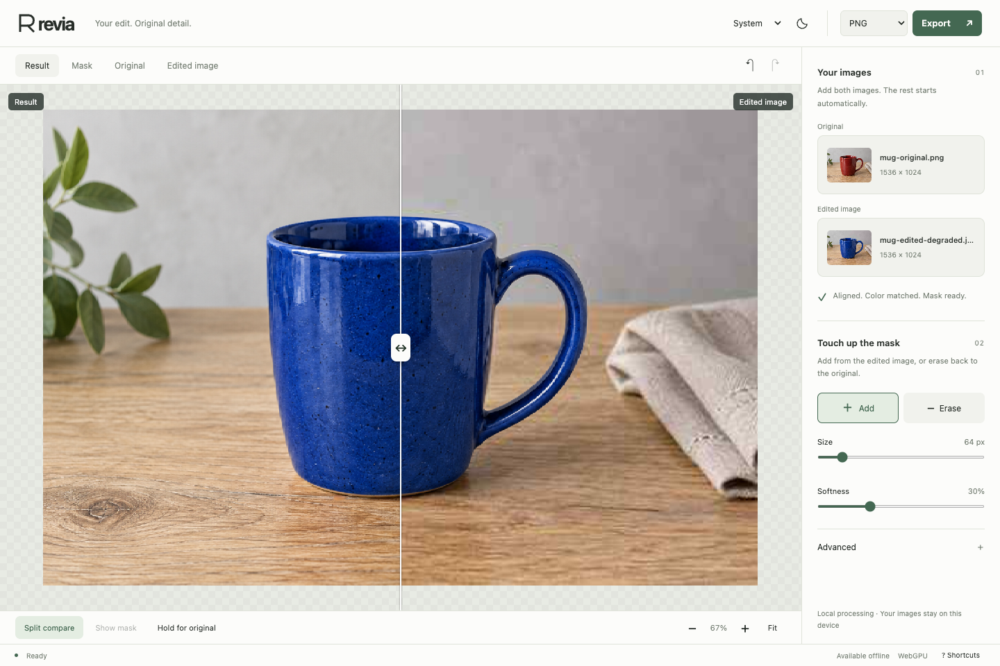
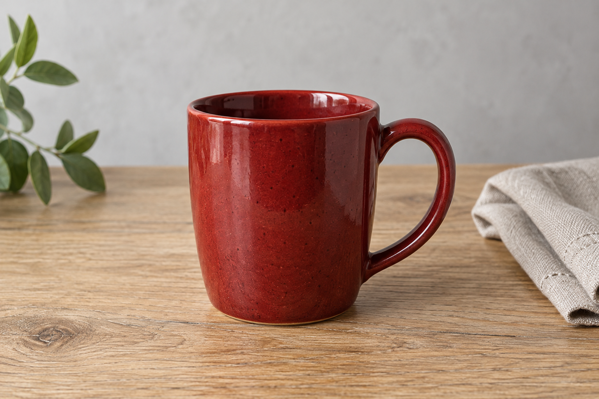
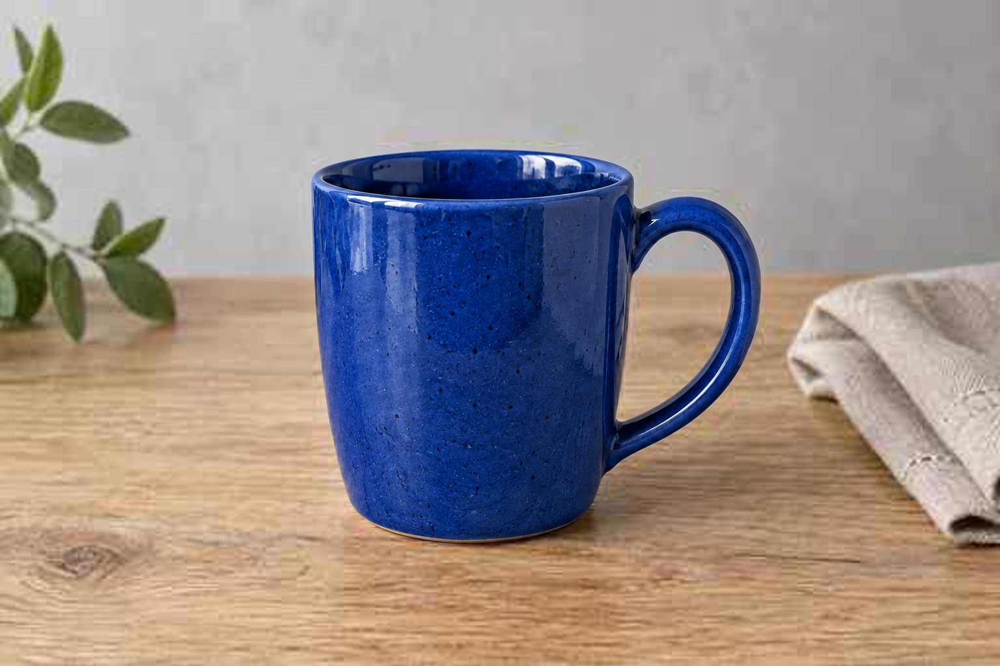

English · [简体中文](README_CN.md)

# Revia

**Your edit. Original detail.**

Add an original image and an edited version. Revia aligns their positions, matches their colors, and automatically builds a mask to keep the edit without replacing the rest of the original detail. Touch up with two brushes, then export. Everything runs on your device.

<picture>
  <source media="(prefers-color-scheme: dark)" srcset="images/editor-dark.png">
  
</picture>

## Three steps

1. **Add both images.** Alignment, color matching, and mask generation start automatically.
2. **Touch up if needed.** Use **Add** for content from the edited image and **Erase** to restore the original. Adjust brush size and softness, paint on the result or mask, and undo any changes.
3. **Export.** Choose PNG, Mask PNG, or PSD from the format menu.

Use **Split compare** to drag a vertical divider between the result and the edited image. Both sides share zoom and pan.

The **Advanced** section stays closed until you need it. It contains position adjustments, color matching strength, and detection sensitivity. The default settings adapt to the images automatically.

Refresh or reopen to start with an empty editor. Export your result before leaving.

## Example: recolor a mug

The edited image has a sharp blue mug but degraded background detail. Revia automatically masks the mug and preserves the original pixels outside the mask. You can erase any unwanted changes or brush in missing details.

| Original | Edited input | Automatic result |
| --- | --- | --- |
|  |  |  |

Try [the original](images/mug-original.png) and [the edited input](images/mug-edited-degraded.jpg). The result appears automatically.

## Get started

Install [Node.js 24 or newer](https://nodejs.org/), then open a terminal in your cloned Revia repository.

With npm, included with Node.js:

```sh
npm install
npm start
```

Or with pnpm:

```sh
pnpm install
pnpm start
```

The first start builds the app, starts a local server, and opens your browser. Keep the terminal running while editing; press `Ctrl+C` to stop it. Revia is not published as an npm package.

To open the desktop app, run `npm run desktop` or `pnpm desktop`. On Windows, `npm run package:win` or `pnpm package:win` creates an x64 ZIP in `release/`. Extract it and run `Revia.exe`.

## Command line

After installing dependencies, export directly from two images with the same automatic processing as the editor. No browser or app build is needed.

```sh
npm run cli -- -i images/mug-original.png -e images/mug-edited-degraded.jpg -o result.png -f png
```

Or with pnpm:

```sh
pnpm cli -i images/mug-original.png -e images/mug-edited-degraded.jpg -o result.png -f png
```

Use `-f mask` for a 16-bit mask PNG or `-f psd` for a layered PSD. When `-f` is omitted, `.png` and `.psd` select the output format. Output keeps the original dimensions. Existing files are only replaced with `--overwrite`.

Optional adjustments include `--color-strength 0.8`, `--sensitivity 1.2`, `--feather 4`, and `--offset-x -2`. Position offsets use original-image pixels; `--scale` and `--rotation` apply around the original canvas center after automatic alignment, followed by translation. Color matching and mask detection then use the adjusted position. Use `--align none` for manual positioning, or `--local-warp off` to disable local boundary alignment.

Animated inputs use the first frame by default; choose another with `--original-frame` or `--edited-frame` (starting at 1). Progress is written to the terminal; `--quiet` hides progress and completion messages. Failed exports return a nonzero exit code.

See all parameters and defaults:

```sh
npm run cli -- --help
pnpm cli --help
```

## Included

- PNG, JPEG, and WebP input; choose a frame for animated images.
- Original-size output, 8K images, and supported 16-bit PNG and ICC color profiles.
- Automatic position and color matching, editable masks, and undo/redo during the current session.
- Light and dark themes; Simplified Chinese, Traditional Chinese, English, Japanese, and Korean. The initial language follows your system, with English as the fallback.
- Offline use after the initial resource download. No image uploads.

White mask pixels use the edited image, black pixels keep the original, and gray pixels blend them. Pixels outside the mask keep their original decoded values. PSD is available for supported 8-bit color configurations; PNG preserves supported higher-depth image data.

See [Changelog](CHANGELOG.md) for release notes.

## License

Revia is licensed under the [Apache License 2.0](LICENSE).
